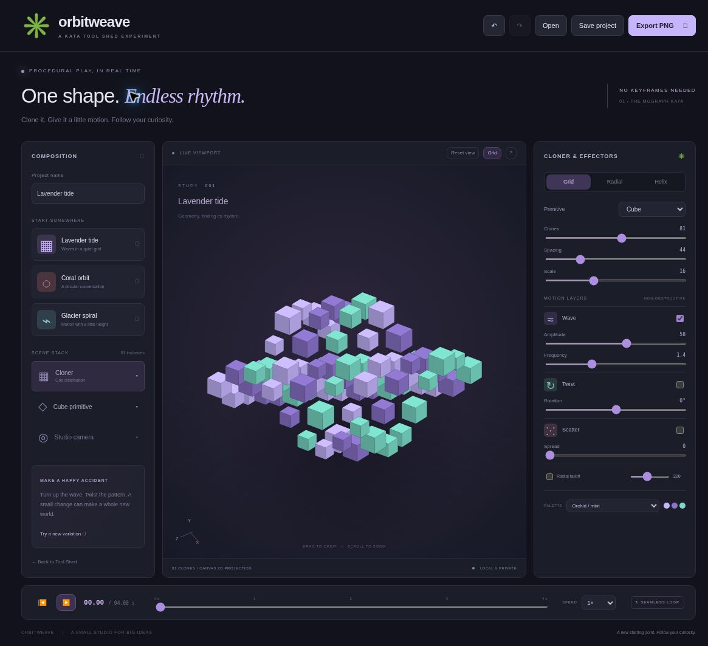

# Kata Orbitweave

**One shape. Endless rhythm.** An original procedural motion playground inspired by Cinema 4D's MoGraph workflow. Build a small world of clones, add wave, twist, and scatter, and discover a satisfying loop.

Part of [Kata Tool Shed](https://intrepion.github.io/tools/). Repository: `kata-app-inspired-by-cinema-4d-codex-dot`.



[View the 390px narrow layout](docs/screenshots/narrow.png). Screenshots are real localhost browser captures; the narrow image includes the centered test wrapper.

## Run locally

Requires Node.js 18+. There are **no runtime or package dependencies** to install.

```sh
npm run dev
```

Open `http://127.0.0.1:4314` in a browser. Do not open `index.html` directly or use `file://`. Choose a port with `PORT=4300 npm run dev` (PowerShell: `$env:PORT=4300; npm run dev`). The server also accepts `--host` and `--port` arguments.

```sh
npm run check   # Syntax checks and 10 model tests
npm run build   # Self-contained static output in dist/
```

Serve `dist/` through an HTTP static server. All assets are local and all rendering is client-side.

## Find your rhythm

1. Start with **Lavender tide**, **Coral orbit**, or **Glacier spiral**.
2. Choose Grid, Radial, or Helix distribution, and Cube or Sphere primitives.
3. Change clone count (6–144), spacing, and size. Clone count always means the exact number of instances.
4. Enable **Wave**, **Twist**, and **Scatter** independently. Wave changes height and gently pulses size. Twist rotates clone positions around the center. Scatter is deterministic for the saved seed.
5. **Radial falloff** weights each effector by distance from the center. Adjust its radius to isolate the middle of the pattern.
6. Pick a color palette. Use **Try a new variation** to change the seed and effect strengths while keeping your layout and colors.
7. Play the seamless loop, scrub its phase, or change speed. Drag to orbit, scroll to zoom, or reset the view.
8. **Save project** downloads editable `.orbitweave` JSON. **Open** validates and restores it. **Export PNG** creates a clean 1800 × 1200 image from the current camera and phase.

Undo/redo holds up to 50 in-memory setting changes. Presets and imports are undoable. The current phase, zoom, grid visibility, and undo history are view/session state and are not saved in a project. Camera yaw and pitch are saved.

## Controls and accessibility

- **Space:** play/pause.
- **Ctrl/⌘ Z / Ctrl/⌘ Shift Z:** undo/redo.
- **Ctrl/⌘ S:** save project.
- Focus the viewport and use **arrow keys** to orbit; **+ / −** to zoom.
- All main settings are labeled native controls. Focus rings, selected states, accessible button labels, and live status messages are included.
- The mobile layout puts the scene above a two-column inspector, with all controls available.

## What this kata is

A deliberately small, procedural **3D-coordinate scene rendered with Canvas 2D orthographic projection**. It is not WebGL, a full 3D modeling package, or a Cinema 4D replacement. Cubes use depth-sorted faces and spheres use painted radial shading. Intersecting geometry can show painter-order artifacts. Extreme spacing or zoom can move geometry outside the viewport.

There is no polygon editing, extruded text, arbitrary mesh import, native C4D support, simulation, physics, object collisions, ray tracing, shadows with geometric occlusion, keyframe editor, or video export. Effectors apply in a fixed order: wave, scatter, then twist. The radial layout distributes instances across three interleaved rings. The helix spans 2.5 turns.

The loop phase is periodic, and all procedural animation returns to its starting state. The nominal cycle is four seconds at 1×. Speed changes playback rate, not the underlying scene.

## Persistence and privacy

There is no server-side data, telemetry, remote asset fetch, or upload. Autosave stores one latest composition in this origin's local storage under an app-specific key. Storage may fail or be cleared. **Download project files for durable backups.** Undo history does not survive reload.

Presets and imports ask before replacing changes since the last project download. Import validation checks format/version, every numeric range, integer clone count and seed, layout, shape, palette, speed, and Boolean effect states. Files are capped at 100 KB; unknown fields are discarded. Project names are rendered as text rather than HTML.

## Tests and documentation

- `npm run check`: Node model tests and JavaScript syntax.
- `http://127.0.0.1:4314/tests/browser.html`: self-running interaction tests for layouts, render changes, history, effectors, project round trips, invalid input, PNG export, playback, camera, dialogs, and mobile overflow.
- `tests/responsive.html`: 390px narrow viewport wrapper.
- [Research and scope](docs/INSPIRATION.md).
- [Verification record](docs/QA.md).
- `app.json`: Tool Shed catalog metadata.

The browser test harness mocks downloads and accepts its own replacement dialogs. It is excluded from the production build. The harness resets only this app’s dedicated autosave key before and after its checks.

## License and inspiration

MIT. Original code, procedural graphics, and interface assets. Inspired by [Cinema 4D MoGraph](https://www.maxon.net/en/cinema-4d/features/mograph-basics), without affiliation or endorsement. No proprietary assets or software are included. The combined `.gitignore` covers Windows, macOS, Linux/Unix, editors, build outputs, dependency folders, local secrets, and test artifacts.

## Publishing

The GitHub Pages workflow checks and builds the app on pushes to `main` or manual dispatch, then deploys `dist/`. In repository Settings → Pages, choose **GitHub Actions** as the source. Deployment is separate from the local QA recorded above.


## Published app

Open [Kata Orbitweave](https://intrepion.github.io/kata-app-inspired-by-cinema-4d-codex-dot/). The public repository uses GitHub Actions to verify and deploy `dist/` from `main`. See [QA notes](docs/QA.md) for local verification and known limits.
